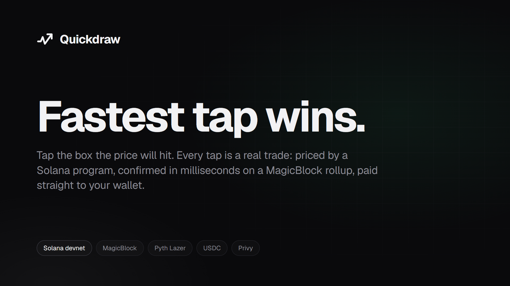
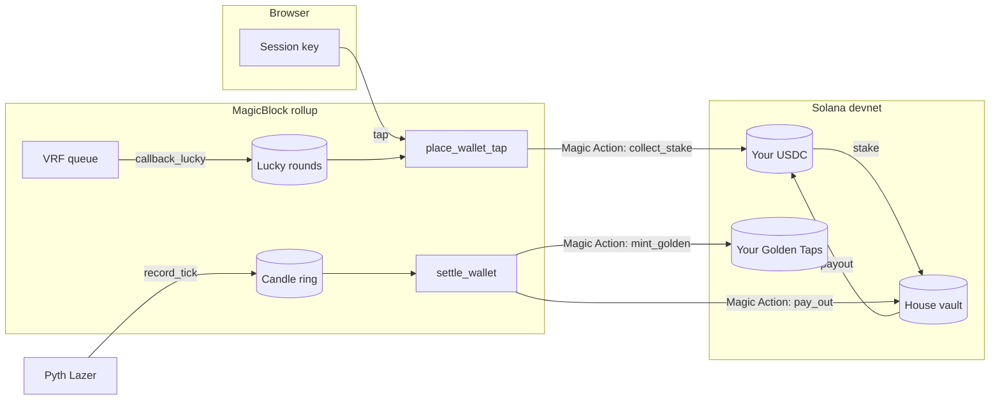

<div align="center">



# Quickdraw

**Fastest tap wins.** Tap the box the price will hit. Every tap is a real on-chain trade.

[Play on devnet](https://quickdraw-beta.vercel.app) · [Program](https://explorer.solana.com/address/7TBHSjenh1DFt7C8vnNVfXDLbZ3cCgEeAa4XcTUvF6Au?cluster=devnet) · [Golden Tap](https://explorer.solana.com/address/ETsjfkbgiMEAmya1EgytD779DG3FuQAnFs5sPBDCEZP?cluster=devnet) · [Keeper status](https://quickdraw-keeper-hocm.onrender.com/health)

</div>

---

## The game

```
          4s      8s      12s     16s
        ┌───────┬───────┬───────┬───────┐
 89.42  │  27x  │  20x  │ ★17x  │  15x  │
 89.41  │  3.3x │  3.4x │ ★3.5x │  3.6x │
 89.40 ─┼─ 1.4x ┼─ 1.5x ┼─ 1.5x ┼─ 1.5x ┼──  live price
 89.39  │  3.5x │  3.6x │ ★3.6x │  3.7x │
 89.38  │  30x  │  23x  │ ★19x  │  16x  │
        └───────┴───────┴───────┴───────┘
                          golden column
```

- **Rows** are price bands, **columns** are 4-second windows.
- **Tap a box.** If the price trades inside it during its window, you win its multiplier.
- **Near boxes** pay about 1.4x, **far boxes** up to 50x. One box per column.
- **Wins pay instantly** when the price touches. Losses settle when the column closes.
- **Golden column:** about every 30 seconds, MagicBlock VRF picks one column per market. A win of 2x or more there also mints a **Golden Tap** collectible to your wallet.

## Why it's different

| | Typical tap-trading game | Quickdraw |
|---|---|---|
| Odds | Set off-chain, edge hidden | Priced by the program on every tap |
| Results | Taken on trust | Settled from an on-chain price record |
| Randomness | Server-side, unverifiable | MagicBlock VRF, verified by the program |
| Money | Deposit first | No deposit: USDC stays in your wallet |
| Onboarding | Wallet app, seed phrase, gas | Google or X sign-in, no popups, no gas |
| Speed | Seconds per trade | About 150 ms on a MagicBlock rollup |

## Features

| Feature | |
|---|---|
| Instant taps | 150–250 ms confirmations on a MagicBlock ephemeral rollup |
| Social sign-in | Privy embedded wallet from Google or X; the house pays every fee |
| Wallet play | Stakes leave your wallet only when you tap; wins land straight back |
| On-chain odds | Priced from live volatility; you never get less than the multiplier you saw |
| Golden columns | One column per market each round, drawn by MagicBlock VRF on the rollup |
| Golden Taps | A collectible SPL token (GTAP) minted to the winner by a Magic Action |
| Golden Hall | Leaderboard of Golden Tap holders; holders show in gold across the app |
| Proof per tap | The window's recorded price range drawn against your box, with explorer links |
| Markets | SOL, BTC and ETH from Pyth Lazer |
| Multiplayer | Live feed of every tap, P&L leaderboard, house pool stats |
| Profile | P&L, receipts, achievements, Golden Taps, session loss limit, shareable win cards |
| Keyboard | `1`–`4` stake, `S` `B` `E` market, `?` help |

## Architecture



| Piece | Role |
|---|---|
| Anchor program | One program on both layers: markets, odds, taps, settlement, golden rounds, house book |
| Rollup | Player accounts, house book, candle rings and golden rounds live here for speed |
| Solana | Vault, ledger, USDC balances and Golden Taps stay on the base layer |
| Keeper | Cranks `record_tick` (reads the oracle on-chain; cannot invent a price), requests each round's VRF draw, settles taps |
| Settlement | Permissionless: the keeper or the player's own browser can call it |

## How money moves

| Step | Where | What happens |
|---|---|---|
| 1. Sign in | Solana | Wallet approves the vault to spend USDC (nothing moves), opens a ledger and a Golden Tap account, delegates the player to the rollup |
| 2. Tap | Rollup, about 150 ms | Checks live balance and allowance, prices the box, flags a golden-column tap, schedules `collect_stake` |
| 3. Stake | Solana, about 1 s later | A Magic Action moves just that stake from the wallet to the vault |
| 4. Settle | Rollup | Judged from the candle ring; a win schedules `pay_out`, a 2x+ golden win also `mint_golden` |
| 5. Payout | Solana | Magic Actions send the payout and the Golden Tap straight to the wallet |

`collect_stake`, `pay_out` and `mint_golden` accept only calls signed by the program's own escrow PDA through the delegation program. Nobody else can trigger them. A stake that never arrives voids its tap after 30 s. The Golden Tap mint can never block or undo a payout: it is a separate action that skips if the wallet has no Golden Tap account.

## Golden columns

| | |
|---|---|
| Round | 28 seconds (7 columns); one VRF seed per round |
| Draw | `request_lucky` asks MagicBlock VRF on the rollup (free, under a second); permissionless |
| Callback | `callback_lucky` stores the seed once, signed by the program's scoped VRF identity; a round can never be redrawn |
| Pick | The seed mixed with the market address selects one column per market |
| Reward | A win of 2x or more in the golden column mints one Golden Tap; payouts are unchanged, so the house carries no extra risk |
| Token | GTAP, 0 decimals, mint authority held by the program's `golden-auth` PDA |

## Odds

| | |
|---|---|
| Model | Probability the price touches the band during the window |
| Movement | Drift before the window plus wander inside it, 12-point Gauss-Legendre |
| Volatility | Last 30 s of the on-chain candle ring, with a per-market floor |
| Safety | Prices a calm and a jumpy scenario, quotes the more likely one |
| Your price | Pays at most the quoted multiplier; rejects the tap below your slippage floor |
| Backtest | Return to player at or below 95% in every multiplier bucket on recorded candles |

House book: 10% edge, 1.1x–50x, $50 max profit per tap, open exposure at most 50% of the pool. Boxes over a limit are struck through, so the grid never offers a trade the program would reject.

## Tech stack

| Layer | Stack |
|---|---|
| Program | Rust, Anchor 1.2, MagicBlock `ephemeral-rollups-sdk` 0.17 (rollups, Magic Actions, VRF), SPL Token, Metaplex metadata |
| Data | Pyth Lazer via MagicBlock oracle, Circle devnet USDC |
| App | Next.js 15, React 19, Privy, canvas grid, Geist |
| SDK | TypeScript, `@solana/web3.js`, odds and golden-column math shared with the program |
| Keeper | Node 22, Docker on Render |

## Repository

```
quickdraw/
├── programs/quickdraw   Anchor program (odds, taps, settlement, golden rounds, Magic Actions, house book)
├── sdk                  TypeScript client: PDAs, decoders, instructions, odds and golden math
├── keeper               Oracle ticks, VRF rounds, settlement, player welcome, setup scripts
└── app                  Next.js game
```

## Run locally

Node 22 and pnpm 10. The Solana toolchain is only needed to build the program.

```bash
pnpm install
```

`app/.env.local`:

```bash
NEXT_PUBLIC_KEEPER_URL=https://quickdraw-keeper-hocm.onrender.com
NEXT_PUBLIC_PRIVY_APP_ID=<privy app id>
NEXT_PUBLIC_BASE_RPC=<optional devnet RPC; falls back to public devnet>
```

| Command | Does |
|---|---|
| `pnpm dev` | App on http://localhost:3000 against the live devnet program |
| `KEEPER_KEYPAIR=key.json pnpm keeper` | Run your own keeper |
| `anchor build` | Build the program |
| `cargo test -p quickdraw` | Odds, settlement and golden-column unit tests |
| `pnpm --filter @quickdraw/keeper e2e:wallet` | Full wallet-play loop on devnet |
| `PLAYER_KEYPAIR=key.json pnpm --filter @quickdraw/keeper exec tsx src/golden-e2e.ts` | Golden column on devnet: VRF draw, golden tap, Golden Tap mint |

## Deploy

**Keeper on Render** (Docker, `keeper/Dockerfile` or `render.yaml`)

| Variable | Purpose |
|---|---|
| `KEEPER_SECRET` | Keeper wallet keypair (JSON array) |
| `PRIVY_APP_ID` | Verifies sign-ins with Privy's public keys |
| `BASE_RPC` | Optional devnet RPC |
| `WELCOME_USDC`, `WELCOME_BUDGET` | Starter USDC per wallet ($1) and per process ($15) |
| `WELCOME_SOL_BUDGET`, `WELCOME_PER_IP_HOUR` | Fee budget (3 SOL) and per-IP limit (6/h) |
| `BOT_SECRETS` | Optional house players (see below) |

The keeper also serves `/health`, `/bots` and `/golden` (Golden Tap holders).

**App on Vercel:** root directory `app`; set `NEXT_PUBLIC_KEEPER_URL` and `NEXT_PUBLIC_PRIVY_APP_ID`. In Privy, enable Google, Twitter and Solana embedded wallets, and allow the site's domain.

**Golden columns, once per deployment:** `keeper/src/golden-mint.ts` creates the Golden Tap mint, the round account on the rollup (`lucky`), its metadata (`metadata`), and hands minting to the program (`handoff`).

**House players:** the house can run a few wallets that tap with small stakes so the market is never empty. They follow exactly the same rules and odds as everyone, and the keeper lists their addresses at `/bots`.

## Devnet

| | |
|---|---|
| Program | `7TBHSjenh1DFt7C8vnNVfXDLbZ3cCgEeAa4XcTUvF6Au` |
| Golden Tap (GTAP) | `ETsjfkbgiMEAmya1EgytD779DG3FuQAnFs5sPBDCEZP` |
| USDC | `4zMMC9srt5Ri5X14GAgXhaHii3GnPAEERYPJgZJDncDU`, free at [faucet.circle.com](https://faucet.circle.com/) |
| Rollup | `devnet-as.magicblock.app` |
| VRF queue (rollup) | `5hBR571xnXppuCPveTrctfTU7tJLSN94nq7kv7FRK5Tc` |

---

<div align="center">

Devnet only, not audited, no real money.

</div>
