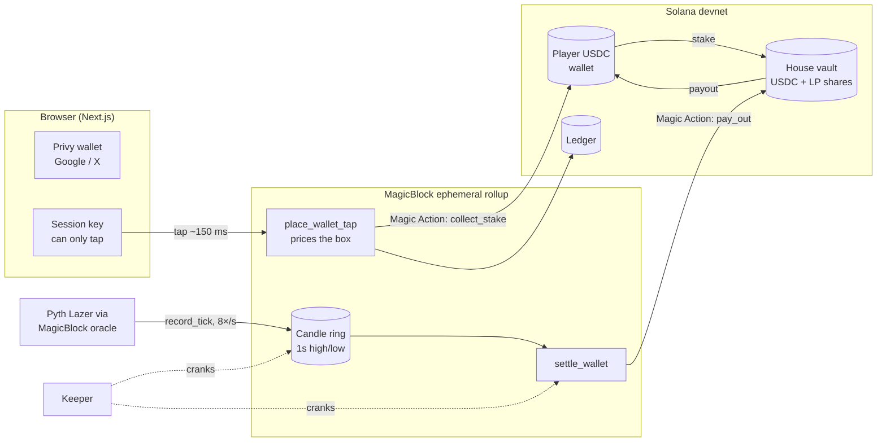

<div align="center">


# Quickdraw

**Fastest tap wins.** Tap trading on Solana: tap the box the price will hit.

[**Play on devnet**](https://quickdraw-beta.vercel.app) · [Program on Explorer](https://explorer.solana.com/address/7TBHSjenh1DFt7C8vnNVfXDLbZ3cCgEeAa4XcTUvF6Au?cluster=devnet) · [Keeper health](https://quickdraw-keeper.onrender.com/health)

Built for the [MLH x Solana Hackathon](https://events.mlh.com/events/15200-solana-hackathon), Nov 6–8, 2026

</div>

---

A live SOL, BTC or ETH price becomes a grid. Rows are price bands, columns are 4-second windows. Tap a box. If the price trades inside it during that window, you win the box's multiplier, paid straight to your wallet.

Every tap is a real on-chain trade in USDC. The program prices it and settles it from on-chain oracle data, on a MagicBlock ephemeral rollup, in about 150–250 ms.

## Why it's different

| | Typical tap-trading game | Quickdraw |
|---|---|---|
| **Odds** | Set off-chain, edge unpublished | Computed by the program on every tap; edge and limits are public |
| **Results** | Taken on trust | Settled from an on-chain price record, with a proof for every tap |
| **Money** | Deposit into the game first | No deposit. USDC stays in your wallet; each tap pulls only its stake |
| **Onboarding** | Wallet app, seed phrase, gas | Sign in with Google or X. No popups, no gas, no SOL needed |
| **Speed** | Seconds per on-chain trade | ~150–250 ms on a MagicBlock rollup |

## How it plays

1. **Sign in** with Google or X. Privy creates an embedded Solana wallet; the house covers network fees and sends a little starter devnet USDC.
2. **Pick a stake** ($0.50–$5) and a market (SOL, BTC, ETH).
3. **Tap a box.** Near boxes pay ~1.4x; far ones pay up to 50x. One box per column.
4. **Watch it land.** A win pays the moment the price touches your box; a loss settles when its column closes.
5. **Check it.** Open any result to see its window's recorded price range drawn against your box, then share wins to X.

Also in the app: a live feed of everyone's taps, a leaderboard, the house pool's state, a profile with P&L, receipts and achievements, a session loss limit, a light theme, sound, and keyboard shortcuts (`1`–`4` stakes, `S` `B` `E` markets, `?` help).

## Architecture



- **One Anchor program** runs on both layers. Player accounts, the house book and per-market candle rings are delegated to the rollup; the vault, the ledger and every USDC balance stay on Solana.
- **Prices:** the keeper cranks `record_tick`, which reads the Pyth Lazer feed through MagicBlock's oracle *on-chain* into a per-second high/low ring. The keeper cannot write a price of its own.
- **Settlement is permissionless:** anyone can call `settle_wallet`. The keeper does it, and so does the player's own browser.

## How money moves

Wallet play means there is no deposit and no cash-out step: **your balance is your wallet.**

1. **Sign-in (Solana, one silent transaction).** The wallet approves the house vault PDA to spend its USDC with an SPL `approve`; nothing moves. The same transaction opens a `Ledger` and delegates the player account to the rollup.
2. **Tap (rollup).** `place_wallet_tap` reads a live copy of the wallet's token account and checks balance and allowance against stakes still in flight. It prices the box, records the tap, and schedules a **Magic Action**: `collect_stake` runs on Solana about a second later, moving just that stake to the vault and marking it in the ledger.
3. **Settle (rollup).** `settle_wallet` judges taps from the candle ring. A win pays only once the ledger shows its stake collected, through a second Magic Action, `pay_out`, straight to the wallet. A stake that never arrives voids its tap after 30 s.

`collect_stake` and `pay_out` move value, so they accept only calls from the delegation program carrying the escrow signature of the program's own `escrow-auth` PDA. Nobody else can trigger them.

## Odds

The program prices each box as the probability that the price **touches** that band during that window, then applies the house edge:

- **Two phases of movement:** drift before the window opens, and the smaller wander inside it. The touch probability is integrated with 12-point Gauss-Legendre quadrature.
- **Two volatility scenarios:** calm and jumpy. The program quotes the *more likely* of the two, so a quiet minute can't make far boxes underpriced.
- **Volatility** comes from the last 30 s of the on-chain candle ring, with a per-market floor.
- **You get what you saw:** the tap carries the multiplier you were shown and a slippage floor. The program pays at most the quoted multiplier, and rejects the tap if the live price drifted below your floor.

The scales were fitted on recorded oracle data. In a backtest over recorded candles, return to player stayed at or below 95% in every multiplier bucket, so no row of the grid is a free lunch for players.

**House book (live on devnet):** 10% edge · 1.1x–50x multipliers · $50 max profit per tap · open exposure capped at 50% of the pool. Boxes that would break a limit are shown struck through, so the grid never offers a trade the program would reject.

## Tech stack

| Layer | Stack |
|---|---|
| Program | Rust, Anchor 1.2, MagicBlock `ephemeral-rollups-sdk` 0.17 (delegation, Magic Actions), SPL Token |
| Data | Pyth Lazer via MagicBlock's ephemeral oracle, Circle devnet USDC |
| Client | TypeScript SDK sharing the program's odds math, `@solana/web3.js` |
| App | Next.js 15, React 19, Privy (Google / X, embedded Solana wallets), canvas grid, Geist |
| Keeper | Node 22, `tsx`, `jose` (Privy token checks), Docker on Render |

## Repository

| Path | What |
|---|---|
| [`programs/quickdraw`](programs/quickdraw) | Anchor program: markets, candle ring, on-chain odds, taps, wallet play and Magic Actions, settlement, USDC house book with LP shares |
| [`sdk`](sdk) | TypeScript client: PDAs, account decoders, IDL-driven instructions, the same odds math as the program |
| [`keeper`](keeper) | Always-on service: records oracle ticks, settles taps, funds new players and the action escrow; setup and end-to-end scripts |
| [`app`](app) | The Next.js game |

## Run it locally

Requires Node 22 and pnpm 10. The Solana / Anchor toolchain is only needed to build the program.

```bash
pnpm install
```

**App** (uses the deployed devnet program and keeper): create `app/.env.local` with

```bash
NEXT_PUBLIC_KEEPER_URL=https://quickdraw-keeper.onrender.com
NEXT_PUBLIC_PRIVY_APP_ID=<your Privy app id>
# optional: a dedicated devnet RPC such as Helius
NEXT_PUBLIC_BASE_RPC=https://devnet.helius-rpc.com/?api-key=<key>
```

then `pnpm dev` and open http://localhost:3000.

**Keeper:** `KEEPER_KEYPAIR=path/to/keypair.json pnpm keeper`. The keypair needs devnet SOL.

**Program:**

```bash
anchor build
cargo test -p quickdraw                                     # odds and settlement unit tests
pnpm --filter @quickdraw/keeper e2e:wallet                  # full wallet-play loop on devnet
```

## Deploy

**Keeper on Render.** A Docker web service from this repo (`keeper/Dockerfile`, or New → Blueprint with `render.yaml`). Environment variables:

| Variable | Purpose |
|---|---|
| `KEEPER_SECRET` | The keeper wallet's keypair JSON array |
| `PRIVY_APP_ID` | Verifies Privy login tokens with Privy's public keys (no app secret needed) |
| `BASE_RPC` | Optional dedicated devnet RPC |
| `WELCOME_USDC` / `WELCOME_BUDGET` | Starter USDC per wallet ($1) and per process ($15) |
| `WELCOME_SOL_BUDGET` / `WELCOME_PER_IP_HOUR` | Fee sponsorship budget (3 SOL) and per-IP limit (6/hour) |
| `BOT_SECRETS` | Optional demo crowd (see below) |

The free plan sleeps after about 15 minutes without inbound traffic, which stops ticks and settlement, so ping `/health` every few minutes (UptimeRobot works).

**App on Vercel.** Import the repo with **Root Directory** `app`, and set `NEXT_PUBLIC_KEEPER_URL`, `NEXT_PUBLIC_PRIVY_APP_ID` and optionally `NEXT_PUBLIC_BASE_RPC`. In the Privy dashboard, enable Google and Twitter login and Solana embedded wallets, and add the site under allowed origins.

**One-time devnet setup** (already done for the program above):

```bash
HOUSE_KEYPAIR=path/to/house.json MARKETS=SOL,BTC,ETH pnpm --filter @quickdraw/keeper bootstrap
```

### Demo crowd

So a visitor never lands on an empty market, the keeper can run a few house wallets that tap every 20–90 s with small stakes. They play by exactly the same rules as everyone else: same pricing, same settlement, real devnet USDC. **The app labels them `demo·`** in the live feed and leaderboard. Set them up with `BOT_KEYPAIRS=a.json,b.json pnpm --filter @quickdraw/keeper bots:setup`, then pass the keys to the keeper as `BOT_SECRETS`.

## Devnet addresses

| | |
|---|---|
| Program | `7TBHSjenh1DFt7C8vnNVfXDLbZ3cCgEeAa4XcTUvF6Au` |
| USDC (Circle devnet) | `4zMMC9srt5Ri5X14GAgXhaHii3GnPAEERYPJgZJDncDU`. More is free at [faucet.circle.com](https://faucet.circle.com/) |
| Rollup | `devnet-as.magicblock.app` |

## What's next

- On-chain scheduled settlement with MagicBlock cranks instead of the keeper
- An in-app screen for adding house liquidity (`lp_add` / `lp_remove` already work)
- More markets, a security review, then mainnet

---

<div align="center">

Devnet only. Not audited, not financial advice, and no real money involved.

</div>
