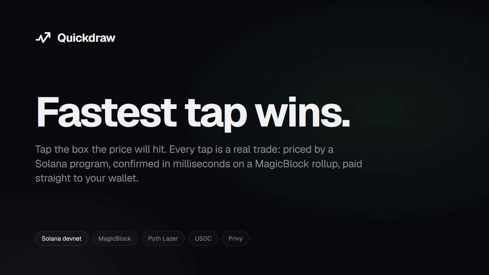
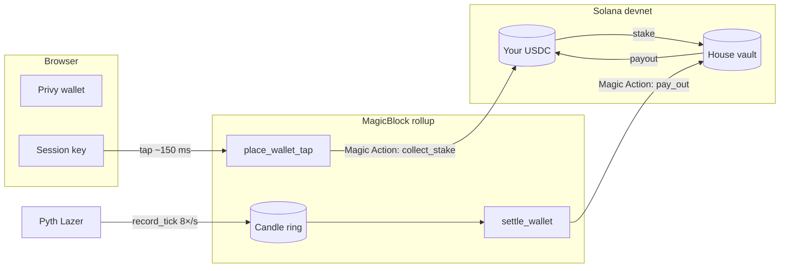

<div align="center">



# Quickdraw

### Fastest tap wins.

Tap the box the price will hit. Every tap is a real on-chain trade.

[](https://quickdraw-beta.vercel.app)


[Live app](https://quickdraw-beta.vercel.app) · [Program](https://explorer.solana.com/address/7TBHSjenh1DFt7C8vnNVfXDLbZ3cCgEeAa4XcTUvF6Au?cluster=devnet) · [Keeper status](https://quickdraw-keeper.onrender.com/health)

</div>

---

## The game

```
          4s      8s      12s     16s
        ┌───────┬───────┬───────┬───────┐
 89.42  │  27x  │  20x  │  17x  │  15x  │
 89.41  │  3.3x │  3.4x │  3.5x │  3.6x │
 89.40 ─┼─ 1.4x ┼─ 1.5x ┼─ 1.5x ┼─ 1.5x ┼──  ← live price
 89.39  │  3.5x │  3.6x │  3.6x │  3.7x │
 89.38  │  30x  │  23x  │  19x  │  16x  │
        └───────┴───────┴───────┴───────┘
```

- **Rows** are price bands, **columns** are 4-second windows.
- **Tap a box.** If the price trades inside it during its window, you win its multiplier.
- **Near boxes** pay ~1.4x. **Far boxes** pay up to 50x. One box per column.
- **Wins pay instantly** when the price touches. Losses settle when the column closes.

## Why it's different

| | Typical tap-trading game | **Quickdraw** |
|---|---|---|
| Odds | Set off-chain, edge hidden | **Priced by the program on every tap** |
| Results | Taken on trust | **Settled from an on-chain price record** |
| Money | Deposit first | **No deposit.** USDC stays in your wallet |
| Onboarding | Wallet app, seed phrase, gas | **Google or X sign-in.** No popups, no gas |
| Speed | Seconds per trade | **~150 ms** on a MagicBlock rollup |

## Features

| | |
|---|---|
| ⚡ **Instant taps** | ~150–250 ms confirmations on a MagicBlock ephemeral rollup |
| 🔑 **Social sign-in** | Privy embedded wallet from Google or X; the house pays every fee |
| 💸 **Wallet play** | Stakes leave your wallet only when you tap; wins land straight back |
| 🎯 **On-chain odds** | Priced from live volatility; you never get less than the multiplier you saw |
| 🔍 **Proof per tap** | The window's recorded price range drawn against your box, with explorer links |
| 📈 **3 markets** | SOL, BTC, ETH from Pyth Lazer |
| 👥 **Multiplayer** | Live feed of every tap, leaderboard, house pool stats |
| 🏆 **Profile** | P&L, receipts, achievements, session loss limit, shareable win cards |
| ⌨️ **Keyboard** | `1`–`4` stake · `S` `B` `E` market · `?` help |

## Architecture



| Piece | Role |
|---|---|
| **Anchor program** | One program on both layers: markets, odds, taps, settlement, house book |
| **Rollup** | Player accounts, house book and per-second candle rings live here for speed |
| **Solana** | Vault, ledger and every USDC balance stay on the base layer |
| **Keeper** | Cranks `record_tick` (reads the oracle on-chain; can't invent a price) and settles taps |
| **Settlement** | Permissionless: the keeper or the player's own browser can call it |

## How money moves

| Step | Where | What happens |
|---|---|---|
| **1. Sign in** | Solana | Wallet approves the vault to spend USDC (nothing moves), opens a ledger, delegates the player to the rollup |
| **2. Tap** | Rollup, ~150 ms | Checks live balance and allowance, prices the box, schedules `collect_stake` |
| **3. Stake** | Solana, ~1 s later | Magic Action moves just that stake from the wallet to the vault |
| **4. Settle** | Rollup | Judged from the candle ring; a win schedules `pay_out` |
| **5. Payout** | Solana | Magic Action sends the payout straight to the wallet |

> `collect_stake` and `pay_out` accept only calls signed by the program's own escrow PDA through the delegation program. Nobody else can trigger them. A stake that never arrives voids its tap after 30 s.

## Odds

| | |
|---|---|
| **Model** | Probability the price *touches* the band during the window |
| **Movement** | Drift before the window + wander inside it, 12-point Gauss-Legendre |
| **Volatility** | Last 30 s of the on-chain candle ring, with a per-market floor |
| **Safety** | Prices a calm and a jumpy scenario, quotes the more likely one |
| **Your price** | Pays at most the quoted multiplier; rejects the tap below your slippage floor |
| **Backtest** | Return to player ≤ 95% in every multiplier bucket on recorded candles |

**House book:** 10% edge · 1.1x–50x · $50 max profit per tap · open exposure ≤ 50% of the pool. Boxes over a limit are struck through, so the grid never offers a trade the program would reject.

## Tech stack

| Layer | Stack |
|---|---|
| Program | Rust · Anchor 1.2 · MagicBlock `ephemeral-rollups-sdk` 0.17 · SPL Token |
| Data | Pyth Lazer via MagicBlock oracle · Circle devnet USDC |
| App | Next.js 15 · React 19 · Privy · canvas grid · Geist |
| SDK | TypeScript · `@solana/web3.js` · odds math shared with the program |
| Keeper | Node 22 · Docker on Render |

## Repository

```
quickdraw/
├── programs/quickdraw   Anchor program (odds, taps, settlement, Magic Actions, house book)
├── sdk                  TypeScript client: PDAs, decoders, instructions, odds math
├── keeper               Oracle ticks, settlement, player welcome, setup scripts
└── app                  Next.js game
```

## Run locally

Node 22 and pnpm 10. The Solana toolchain is only needed to build the program.

```bash
pnpm install
```

`app/.env.local`:

```bash
NEXT_PUBLIC_KEEPER_URL=https://quickdraw-keeper.onrender.com
NEXT_PUBLIC_PRIVY_APP_ID=<privy app id>
NEXT_PUBLIC_BASE_RPC=<optional devnet RPC; falls back to public devnet>
```

| Command | Does |
|---|---|
| `pnpm dev` | App on http://localhost:3000 against the live devnet program |
| `KEEPER_KEYPAIR=key.json pnpm keeper` | Run your own keeper |
| `anchor build` | Build the program |
| `cargo test -p quickdraw` | Odds and settlement unit tests |
| `pnpm --filter @quickdraw/keeper e2e:wallet` | Full wallet-play loop on devnet |

## Deploy

**Keeper → Render** (Docker, `keeper/Dockerfile` or `render.yaml`)

| Variable | Purpose |
|---|---|
| `KEEPER_SECRET` | Keeper wallet keypair (JSON array) |
| `PRIVY_APP_ID` | Verifies sign-ins with Privy's public keys |
| `BASE_RPC` | Optional devnet RPC |
| `WELCOME_USDC` · `WELCOME_BUDGET` | Starter USDC per wallet ($1) and per process ($15) |
| `WELCOME_SOL_BUDGET` · `WELCOME_PER_IP_HOUR` | Fee budget (3 SOL) and per-IP limit (6/h) |
| `BOT_SECRETS` | Optional house players (see below) |

**App → Vercel:** root directory `app`; set `NEXT_PUBLIC_KEEPER_URL` and `NEXT_PUBLIC_PRIVY_APP_ID`. In Privy, enable Google, Twitter and Solana embedded wallets, and allow the site's domain.

**House players:** the house can run a few wallets that tap with small stakes so the market is never empty. They follow exactly the same rules and odds as everyone, and the keeper lists their addresses at [`/bots`](https://quickdraw-keeper.onrender.com/bots).

## Devnet

| | |
|---|---|
| Program | `7TBHSjenh1DFt7C8vnNVfXDLbZ3cCgEeAa4XcTUvF6Au` |
| USDC | `4zMMC9srt5Ri5X14GAgXhaHii3GnPAEERYPJgZJDncDU` · free at [faucet.circle.com](https://faucet.circle.com/) |
| Rollup | `devnet-as.magicblock.app` |

## Roadmap

- [ ] On-chain scheduled settlement with MagicBlock cranks
- [ ] In-app liquidity screen (`lp_add` / `lp_remove` already work)
- [ ] More markets
- [ ] Security review → mainnet

---

<div align="center">

Built for the [MLH × Solana Hackathon](https://events.mlh.com/events/15200-solana-hackathon) · Devnet only, not audited, no real money

</div>
